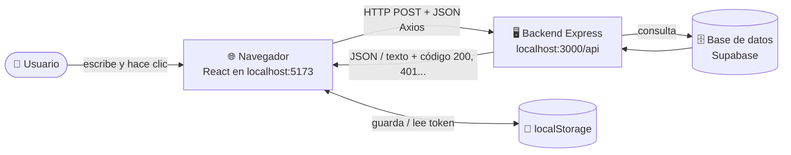
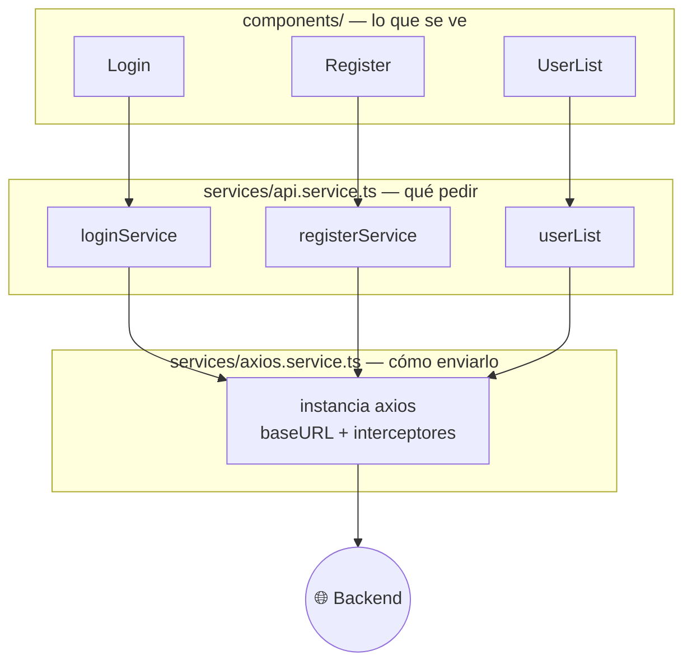
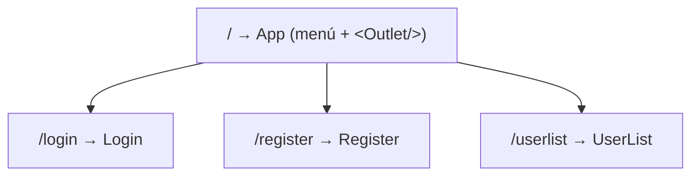
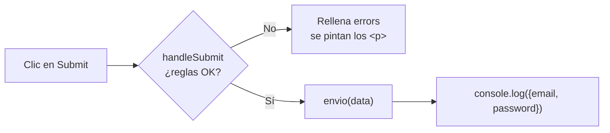
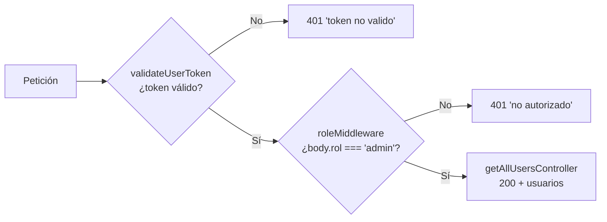
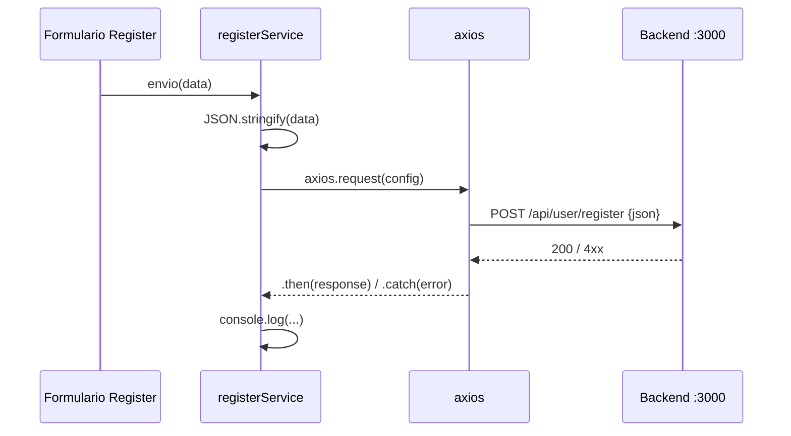
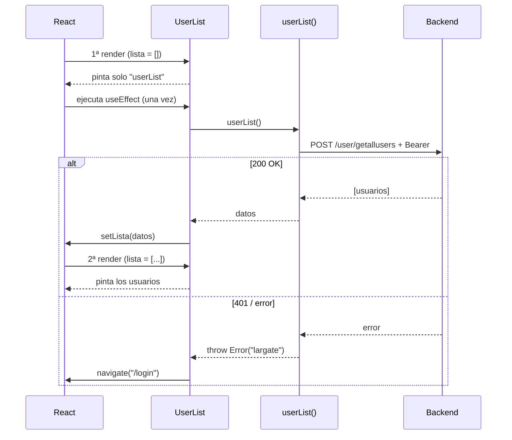
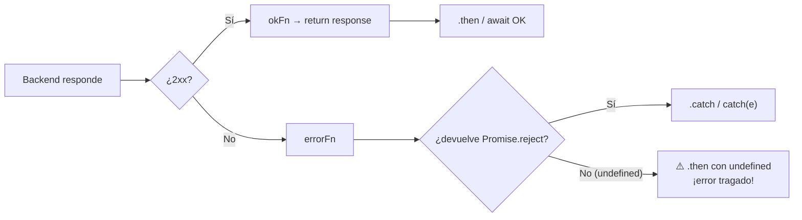
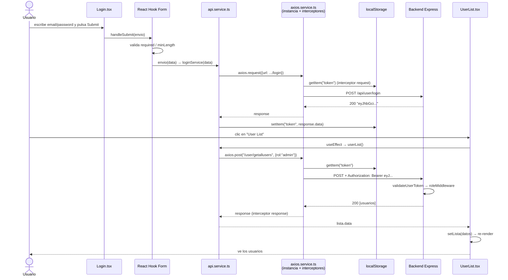

# 🧭 Guía paso a paso: React + React Router + React Hook Form + Axios (con token)

> **Para quién es:** para personas que empiezan desde cero.
> No necesitas saber React. Sí ayuda saber un poco de JavaScript (variables, funciones, objetos).
>
> **Cómo se usa esta guía:** sigue el ritmo **PASO → PRUEBA**.
> Cada vez que escribas algo, lo **pruebas en ese momento**. Si funciona, sigues. Si no, miras la sección "🔨 Rómpelo / 🩹 Arréglalo" de ese paso.
>
> Cada paso tiene 4 bloques:
>
> | Bloque | Para qué sirve |
> |---|---|
> | 🛠️ **PASO** | Lo que escribes o instalas |
> | 🧠 **POR QUÉ** | Qué hace cada línea y para qué |
> | ✅ **PRUEBA** | Cómo comprobar *ahora mismo* que funciona |
> | 🔨 **RÓMPELO / 🩹 ARRÉGLALO** | Cambia algo a propósito, mira qué pasa, y vuelve a dejarlo bien |

---

## 📑 Índice

0. [Qué vamos a construir](#0-qué-vamos-a-construir)
1. [El mapa del proyecto (diagramas)](#1-el-mapa-del-proyecto)
2. [Paso 1 – Instalar las herramientas](#paso-1--instalar-las-herramientas)
3. [Paso 2 – Crear el proyecto con Vite](#paso-2--crear-el-proyecto-con-vite)
4. [Paso 3 – Entender los archivos que creó Vite](#paso-3--entender-los-archivos-que-creó-vite)
5. [Paso 4 – Limpiar y entender `main.tsx`](#paso-4--limpiar-y-entender-maintsx)
6. [Paso 5 – Navegación con React Router](#paso-5--navegación-con-react-router)
7. [Paso 6 – Formulario de Login con React Hook Form](#paso-6--formulario-de-login-con-react-hook-form)
8. [Paso 7 – Formulario de Registro](#paso-7--formulario-de-registro)
9. [Paso 8 – Levantar el backend y probarlo sin React](#paso-8--levantar-el-backend-y-probarlo-sin-react)
10. [Paso 9 – Instalar Axios y registrar usuarios](#paso-9--instalar-axios-y-registrar-usuarios)
11. [Paso 10 – Login y guardar el token en `localStorage`](#paso-10--login-y-guardar-el-token-en-localstorage)
12. [Paso 11 – El archivo `.env` y la instancia de Axios](#paso-11--el-archivo-env-y-la-instancia-de-axios)
13. [Paso 12 – Interceptor de petición: el token viaja solo](#paso-12--interceptor-de-petición-el-token-viaja-solo)
14. [Paso 13 – Lista de usuarios: `useState` + `useEffect`](#paso-13--lista-de-usuarios-usestate--useeffect)
15. [Paso 14 – Interceptor de respuesta y redirección al login](#paso-14--interceptor-de-respuesta-y-redirección-al-login)
16. [El viaje completo de un clic (diagrama de secuencia)](#16-el-viaje-completo-de-un-clic)
17. [Laboratorio: tabla de "¿qué pasa si…?"](#17-laboratorio-qué-pasa-si)
18. [Fallos que tiene el código actual y cómo arreglarlos](#18-fallos-que-tiene-el-código-actual-y-cómo-arreglarlos)
19. [Cómo depurar: el método](#19-cómo-depurar-el-método)
20. [Chuleta final](#20-chuleta-final)

---

## 0. Qué vamos a construir

Una **aplicación web** (lo que ve el usuario en el navegador) con tres pantallas:

| Pantalla | Ruta en el navegador | Qué hace |
|---|---|---|
| Login | `http://localhost:5173/login` | Pides email y contraseña → el servidor te devuelve un **token** → lo guardamos |
| Registro | `http://localhost:5173/register` | Rellenas tus datos → se crea un usuario en la base de datos |
| Lista de usuarios | `http://localhost:5173/userlist` | Pide la lista de usuarios al servidor **enseñando el token**. Si no te dejan, te manda al login |

Esta app **no tiene base de datos propia**. Habla con un **backend** (una API hecha con Express) que ya existe en `../../repaso_supabase` y que escucha en `http://localhost:3000`.

### Las piezas (ingredientes)

| Herramienta | Qué es | Analogía |
|---|---|---|
| **Node.js** | Ejecuta JavaScript fuera del navegador. Lo necesitamos para las herramientas de desarrollo | La electricidad del taller |
| **npm** | Instala librerías (viene con Node) | La tienda de piezas |
| **Vite** | Crea el proyecto y lo sirve en `localhost:5173` mientras programas. Recarga al guardar | El banco de trabajo |
| **React** | Librería para construir interfaces con **componentes** (funciones que devuelven HTML) | Piezas de LEGO |
| **TypeScript** | JavaScript + **tipos**. Te avisa de errores antes de ejecutar | Un corrector ortográfico para código |
| **React Compiler** | Optimiza tus componentes automáticamente | Un mecánico que afina el motor sin que se lo pidas |
| **React Router** | Cambia de "pantalla" según la URL sin recargar la página | Las señales de un edificio |
| **React Hook Form** | Gestiona formularios: valores, validación, errores | Un recepcionista que revisa los papeles antes de pasarlos |
| **Axios** | Hace peticiones HTTP al backend | El cartero |
| **localStorage** | Un pequeño almacén del navegador que sobrevive a recargas | El bolsillo donde guardas la pulsera VIP |

---

## 1. El mapa del proyecto

> 💡 Los diagramas con fondo de código (` ```mermaid `) se ven como dibujos en GitHub y en VS Code si instalas la extensión **"Markdown Preview Mermaid Support"**. Si no, verás el texto; también dejo versiones en ASCII.

### 1.1 Arquitectura: quién habla con quién



```
 [Usuario] ──clic──> [React :5173] ──Axios POST──> [Express :3000/api] ──> [Base de datos]
                          │   ▲                            │
                          │   └────── respuesta ───────────┘
                          ▼
                    [localStorage: token]
```

### 1.2 Estructura de carpetas (estado final)

```
axios/
├── .env                      ← variables de entorno (URL del backend)
├── .gitignore                ← qué NO subir a git
├── index.html                ← la ÚNICA página HTML; tiene <div id="root">
├── package.json              ← lista de librerías y comandos (scripts)
├── vite.config.ts            ← configuración de Vite (+ React Compiler)
├── tsconfig*.json            ← configuración de TypeScript
├── eslint.config.js          ← reglas de calidad de código
├── public/                   ← archivos que se sirven tal cual (favicon)
└── src/
    ├── main.tsx              ← PUNTO DE ENTRADA: monta React y define las rutas
    ├── App.tsx               ← "layout": menú + hueco (<Outlet/>) para cada página
    ├── index.css / App.css   ← estilos
    ├── components/
    │   ├── login.component.tsx      ← formulario de login
    │   ├── register.component.tsx   ← formulario de registro
    │   └── userList.component.tsx   ← lista de usuarios
    └── services/
        ├── axios.service.ts  ← instancia de Axios + interceptores (el "cartero configurado")
        └── api.service.ts    ← funciones que llaman al backend (register, login, userList)
```

### 1.3 Capas: por qué separamos en `components` y `services`



**Regla de oro:** un componente **no** sabe cómo se habla con el servidor; solo llama a una función del servicio. Si mañana cambia la URL del backend, cambias **un** archivo, no diez.

---

## Paso 1 – Instalar las herramientas

### 🛠️ PASO

1. **Node.js (versión LTS)** → https://nodejs.org → descarga "LTS" → siguiente, siguiente, finalizar.
   - Trae dentro **npm**.
2. **Visual Studio Code** → https://code.visualstudio.com
   - Extensiones recomendadas: **ESLint**, **Markdown Preview Mermaid Support**, y opcionalmente **Thunder Client** (para probar APIs).
3. **Git** → https://git-scm.com (para guardar versiones de tu código).
4. **Un navegador con DevTools** (Chrome, Edge o Firefox). Lo abrirás con **F12** constantemente.

### 🧠 POR QUÉ

- El navegador entiende HTML, CSS y JavaScript. Pero **no** entiende TypeScript ni JSX (`<div>` dentro de JS). **Vite**, que corre en **Node**, traduce eso a JavaScript normal en milisegundos.
- **npm** descarga librerías (React, Axios…) de internet a la carpeta `node_modules`.

### ✅ PRUEBA

Abre una terminal (en VS Code: menú *Terminal → New Terminal*) y escribe:

```bash
node -v
npm -v
git --version
```

Debes ver números de versión (por ejemplo `v24.x.x` y `11.x.x`).

### 🔨 RÓMPELO / 🩹 ARRÉGLALO

| Si ves… | Significa | Arreglo |
|---|---|---|
| `'node' no se reconoce como un comando…` | Node no está instalado o la terminal se abrió antes de instalarlo | Cierra **y vuelve a abrir** VS Code / la terminal. Si sigue, reinstala Node |
| `npm : No se puede cargar el archivo ... npm.ps1 porque la ejecución de scripts está deshabilitada` (Windows/PowerShell) | PowerShell bloquea scripts | Ejecuta `Set-ExecutionPolicy -Scope CurrentUser RemoteSigned` y acepta, o usa la terminal **Git Bash** / **cmd** |

---

## Paso 2 – Crear el proyecto con Vite

### 🛠️ PASO

Ve a la carpeta donde guardas tus proyectos y ejecuta:

```bash
npm create vite@latest axios
```

Te hará preguntas. Responde:

```
? Select a framework:  › React
? Select a variant:    › TypeScript + React Compiler
```

(Si te pregunta *"Install with npm and start now?"* puedes decir que sí; si no, haz lo siguiente.)

```bash
cd axios
npm install
npm run dev
```

### 🧠 POR QUÉ

| Comando | Qué hace |
|---|---|
| `npm create vite@latest axios` | Descarga el "creador de proyectos" de Vite y crea la carpeta `axios` con una plantilla |
| `cd axios` | Entra en la carpeta (todos los comandos siguientes deben ejecutarse **dentro**) |
| `npm install` | Lee `package.json` y descarga todas las librerías a `node_modules/` |
| `npm run dev` | Ejecuta el script `"dev": "vite"` de `package.json`: arranca el servidor de desarrollo |

### ✅ PRUEBA

La terminal mostrará algo como:

```
  VITE v8.x  ready in 300 ms
  ➜  Local:   http://localhost:5173/
```

Abre `http://localhost:5173` → verás la página de bienvenida de Vite + React con un contador.

**Prueba de "recarga en caliente" (HMR):** abre `src/App.tsx`, cambia cualquier texto, guarda (Ctrl+S) → el navegador cambia **solo**, sin recargar.

### 🔨 RÓMPELO / 🩹 ARRÉGLALO

1. **Cierra la terminal** donde corre `npm run dev` y recarga el navegador → *"No se puede acceder a este sitio"*.
   🩹 El servidor de desarrollo **tiene que estar encendido** mientras trabajas. Vuelve a ejecutar `npm run dev`.
2. **Ejecuta `npm run dev` fuera de la carpeta** (por ejemplo, en la carpeta padre) → `npm ERR! Missing script: "dev"` o `ENOENT package.json`.
   🩹 `cd axios`. npm busca `package.json` en la carpeta **actual**.
3. **Borra `node_modules`** y lanza `npm run dev` → `'vite' no se reconoce…`.
   🩹 `npm install`. (Por eso `node_modules` **no** se sube a git: se regenera siempre desde `package.json`.)

---

## Paso 3 – Entender los archivos que creó Vite

No hay que escribir nada aquí; es para **entender** qué tienes.

### `package.json` — el DNI del proyecto

```json
{
  "name": "axios",
  "private": true,
  "version": "0.0.0",
  "type": "module",
  "scripts": {
    "dev": "vite",
    "build": "tsc -b && vite build",
    "lint": "eslint .",
    "preview": "vite preview"
  },
  "dependencies": { ... },
  "devDependencies": { ... }
}
```

| Línea | Para qué sirve |
|---|---|
| `"private": true` | Evita publicar por error este proyecto en npm |
| `"type": "module"` | Usa `import/export` (módulos modernos) en vez de `require` |
| `"dev"` | `npm run dev` → servidor de desarrollo (rápido, **no** comprueba tipos) |
| `"build"` | `npm run build` → primero `tsc -b` (comprueba TypeScript; si hay errores **se para**), luego `vite build` genera la carpeta `dist/` lista para subir a internet |
| `"lint"` | `npm run lint` → ESLint revisa el código buscando malas prácticas |
| `"preview"` | Sirve la carpeta `dist/` para probar la versión final |
| `dependencies` | Librerías que la app necesita **para funcionar** (React, Axios…) |
| `devDependencies` | Librerías que solo necesitas **para programar** (TypeScript, ESLint, Vite…) |

> 💡 El `^` en `"axios": "^1.21.1"` significa "esta versión o cualquier 1.x más nueva". `package-lock.json` apunta la versión **exacta** instalada para que todos los compañeros tengan lo mismo.

### `index.html` — la única página

```html
<div id="root"></div>
<script type="module" src="/src/main.tsx"></script>
```

- `<div id="root">` está **vacío**. React lo rellenará.
- El `<script>` carga `main.tsx`, que es donde empieza todo.
- Esto es una **SPA** (*Single Page Application*): solo hay **un** HTML. Cambiar de "página" es React cambiando el contenido de `#root`.

### `vite.config.ts` — configuración de Vite

```ts
import react, { reactCompilerPreset } from '@vitejs/plugin-react'
import babel from '@rolldown/plugin-babel'
import { defineConfig } from 'vite'

export default defineConfig({
  plugins: [
    react(),                                      // 1
    babel({ presets: [reactCompilerPreset()] })   // 2
  ],
})
```

1. `react()` → enseña a Vite a entender JSX y activa la recarga en caliente.
2. `babel(...)` con `reactCompilerPreset()` → activa el **React Compiler**: analiza tus componentes y evita re-renderizados innecesarios (antes había que hacerlo a mano con `useMemo`/`useCallback`).

### `tsconfig.json`, `tsconfig.app.json`, `tsconfig.node.json`

- `tsconfig.json` solo apunta a los otros dos.
- `tsconfig.app.json` → reglas para tu código en `src/`. Las más importantes para ti:

| Opción | Efecto práctico |
|---|---|
| `"jsx": "react-jsx"` | Permite escribir `<div>` dentro de `.tsx` |
| `"noUnusedLocals": true` | **Error** si importas o declaras algo y no lo usas. ⚠️ Esto hará fallar `npm run build` (lo verás en la sección 18) |
| `"noUnusedParameters": true` | Lo mismo con parámetros de funciones |
| `"verbatimModuleSyntax": true` | Obliga a escribir `import { type X }` cuando importas **solo un tipo**. Por eso verás `type SubmitHandler` |
| `"types": ["vite/client"]` | Hace que TypeScript conozca `import.meta.env` (lo usaremos con el `.env`) |

- `tsconfig.node.json` → reglas para `vite.config.ts` (que corre en Node, no en el navegador).

### `eslint.config.js`

Activa reglas recomendadas de JavaScript, TypeScript y de **hooks de React** (por ejemplo, te avisa si a un `useEffect` le falta una dependencia).

### `.gitignore`

Lista de cosas que git **no** debe guardar: `node_modules`, `dist`, logs…
> ⚠️ **Falta `.env`**. Lo arreglamos en el Paso 11.

### ✅ PRUEBA

```bash
npm run lint
```

En un proyecto recién creado no debe mostrar errores.

### 🔨 RÓMPELO / 🩹 ARRÉGLALO

- En `index.html` cambia `id="root"` por `id="raiz"` → pantalla **en blanco**. Abre F12 → Consola: verás un error del tipo *"Target container is not a DOM element"*.
  🩹 `main.tsx` busca `getElementById("root")`. El id del HTML y el del JS **tienen que coincidir**. Vuelve a poner `root`.

---

## Paso 4 – Limpiar y entender `main.tsx`

### 🛠️ PASO

Deja `src/App.tsx` mínimo:

```tsx
import "./App.css";

function App() {
  return <h1>Hola, funciono</h1>;
}

export default App;
```

Y mira `src/main.tsx` (la plantilla ya lo trae así):

```tsx
import { StrictMode } from "react";
import { createRoot } from "react-dom/client";
import "./index.css";
import App from "./App.tsx";

createRoot(document.getElementById("root")!).render(
  <StrictMode>
    <App />
  </StrictMode>,
);
```

### 🧠 POR QUÉ (línea a línea)

| Código | Qué hace |
|---|---|
| `import { StrictMode } from "react"` | Trae un "modo estricto" que en desarrollo te avisa de errores comunes |
| `import { createRoot } from "react-dom/client"` | `react-dom` es la parte de React que pinta en el **navegador** |
| `import "./index.css"` | Carga estilos globales. Sí: en Vite puedes importar CSS desde JS |
| `import App from "./App.tsx"` | Trae el componente principal (exportado con `export default`) |
| `document.getElementById("root")` | Busca el `<div id="root">` del `index.html` |
| `!` | Le dice a TypeScript "confía en mí, esto **no** es `null`". Sin él, TS se queja porque `getElementById` podría no encontrar nada |
| `.render(<StrictMode><App/></StrictMode>)` | Pinta `App` dentro de `#root` |

**¿Qué es un componente?** Una **función** cuyo nombre empieza en **Mayúscula** y que **devuelve JSX** (algo que parece HTML).

### ✅ PRUEBA

El navegador debe mostrar **"Hola, funciono"**.

### 🔨 RÓMPELO / 🩹 ARRÉGLALO

1. Renombra `function App` a `function app` (minúscula) y en `main.tsx` usa `<app />` → no se pinta nada / aviso en consola.
   🩹 React trata las etiquetas en **minúscula** como HTML (`<div>`, `<p>`) y en **Mayúscula** como componentes. Siempre Mayúscula.
2. Devuelve dos elementos sin envolver: `return <h1>A</h1><h2>B</h2>;` → error de sintaxis (*"Adjacent JSX elements must be wrapped…"*).
   🩹 Un componente devuelve **un solo** elemento raíz. Envuélvelos en `<> ... </>` (un **Fragment**: un envoltorio invisible).
3. Quita `export default App;` → error *"does not provide an export named 'default'"*.
   🩹 Lo que no se exporta, no se puede importar.

---

## Paso 5 – Navegación con React Router

Objetivo: tener un menú fijo y que, según la URL, se muestre Login, Register o UserList **sin recargar la página**.

### 🛠️ PASO 5.1 — Instalar

```bash
npm install react-router
```

(Con el servidor `npm run dev` parado o en otra terminal; luego vuelve a lanzarlo.)

### 🛠️ PASO 5.2 — Crear tres componentes "de mentira" (placeholders)

Crea la carpeta `src/components/` y dentro:

`src/components/login.component.tsx`
```tsx
export function Login() {
  return <h2>Soy el Login</h2>;
}
```

`src/components/register.component.tsx`
```tsx
export function Register() {
  return <h2>Soy el Registro</h2>;
}
```

`src/components/userList.component.tsx`
```tsx
export function UserList() {
  return <h2>Soy la lista</h2>;
}
```

> 💡 Aquí usamos `export function` (**export con nombre**), no `export default`. Por eso al importarlos se usan llaves: `import { Login } from ...`.

### 🛠️ PASO 5.3 — Definir las rutas en `main.tsx`

```tsx
import { StrictMode } from "react";
import { createRoot } from "react-dom/client";
import "./index.css";
import App from "./App.tsx";
import { createBrowserRouter, RouterProvider } from "react-router";
import { Login } from "./components/login.component.tsx";
import { Register } from "./components/register.component.tsx";
import { UserList } from "./components/userList.component.tsx";

const router = createBrowserRouter([
  {
    path: "/",
    Component: App,
    children: [
      { path: "/login", Component: Login },
      { path: "/register", Component: Register },
      { path: "/userlist", Component: UserList },
    ],
  },
]);

createRoot(document.getElementById("root")!).render(
  <StrictMode>
    <RouterProvider router={router} />
  </StrictMode>,
);
```

### 🛠️ PASO 5.4 — El menú y el hueco en `App.tsx`

```tsx
import "./App.css";
import { Link, Outlet } from "react-router";

function App() {
  return (
    <>
      <header>
        <nav>
          <ul>
            <li><Link to="/login">Login</Link></li>
            <li><Link to="/register">Register</Link></li>
            <li><Link to="/userlist">User List</Link></li>
          </ul>
        </nav>
      </header>
      <Outlet></Outlet>
    </>
  );
}

export default App;
```

### 🧠 POR QUÉ



```
 ┌───────────── App ─────────────┐
 │  [Login] [Register] [UserList]│  ← siempre visible (header/nav)
 │ ┌───────── <Outlet/> ────────┐│
 │ │  aquí se pinta el "hijo"   ││  ← cambia según la URL
 │ │  que coincida con la URL   ││
 │ └────────────────────────────┘│
 └───────────────────────────────┘
```

| Pieza | Qué hace |
|---|---|
| `createBrowserRouter([...])` | Crea el "mapa" de rutas: qué componente va con qué URL |
| `path: "/"` + `Component: App` | La ruta raíz pinta `App` |
| `children: [...]` | Rutas **anidadas**: se pintan **dentro** de `App`, en el sitio del `<Outlet/>` |
| `<RouterProvider router={router}/>` | Sustituye a `<App/>`: ahora el router decide qué pintar |
| `<Link to="/login">` | Un enlace que cambia la URL **sin recargar** la página |
| `<Outlet/>` | "Aquí va el hijo". Sin esto, los hijos no tienen dónde aparecer |

### ✅ PRUEBA

1. Abre `http://localhost:5173/` → ves solo el menú.
2. Haz clic en cada enlace → cambia el texto de abajo y la URL.
3. Abre F12 → pestaña **Network** → haz clic en los enlaces → **no** aparecen nuevas cargas del documento HTML. Eso es una SPA.
4. Escribe a mano `http://localhost:5173/userlist` y pulsa Enter → también funciona.

### 🔨 RÓMPELO / 🩹 ARRÉGLALO

| Experimento | Qué pasa | Por qué / arreglo |
|---|---|---|
| Borra `<Outlet></Outlet>` de `App.tsx` | Los enlaces cambian la URL pero **no aparece** el contenido | Los hijos no tienen hueco. Vuelve a ponerlo |
| Cambia un `<Link to="/login">` por `<a href="/login">` | Funciona… pero la página **parpadea** y en Network ves que se recarga todo | `<a>` hace una recarga completa (pierdes el estado). `<Link>` no. Usa `Link` |
| Visita `http://localhost:5173/patata` | Pantalla de error de React Router (*404 Not Found*) | No hay ruta para eso. Podrías añadir `{ path: "*", Component: NoEncontrado }` |
| Importa `{ login }` en minúscula | Error: *does not provide an export named 'login'* | Los nombres deben coincidir **exactamente** (mayúsculas incluidas) |
| Saca `{ path: "/login", ... }` fuera de `children` (al mismo nivel que `/`) | `/login` se ve **sin menú** | Ya no es hija de `App`, así que no se pinta dentro de su `<Outlet/>` |

---

## Paso 6 – Formulario de Login con React Hook Form

### 🛠️ PASO 6.1 — Instalar

```bash
npm install react-hook-form
```

### 🛠️ PASO 6.2 — Formulario que solo hace `console.log`

`src/components/login.component.tsx`:

```tsx
import { useForm, type SubmitHandler } from "react-hook-form";

export function Login() {
  interface Login {
    email: string;
    password: string;
  }

  const envio: SubmitHandler<Login> = (data) => {
    console.log(data); // de momento, solo mirar
  };

  const {
    register,
    handleSubmit,
    formState: { errors },
  } = useForm<Login>();

  return (
    <>
      <form onSubmit={handleSubmit(envio)}>
        <input
          type="email"
          placeholder="email"
          {...register("email", {
            required: "Email is required",
            minLength: { value: 2, message: "Min length is 2" },
          })}
        />
        <p>{errors.email?.message}</p>

        <input
          placeholder="password"
          type="password"
          {...register("password", {
            required: "Password is required",
            minLength: { value: 2, message: "Min length is 2" },
          })}
        />
        <p>{errors.password?.message}</p>

        <button type="submit">Submit</button>
      </form>
    </>
  );
}
```

### 🧠 POR QUÉ (línea a línea)

| Código | Explicación |
|---|---|
| `import { useForm, type SubmitHandler }` | `useForm` es un **hook** (función especial de React que empieza por `use`). `SubmitHandler` es **solo un tipo**, por eso lleva `type` (lo exige `verbatimModuleSyntax`) |
| `interface Login { email: string; password: string }` | Describe la **forma** de los datos del formulario. TypeScript te avisará si escribes `register("emial")` |
| `const envio: SubmitHandler<Login> = (data) => {...}` | La función que se ejecuta **solo si el formulario es válido**. `data` llega como `{ email: "...", password: "..." }` |
| `useForm<Login>()` | Crea el "cerebro" del formulario y nos da herramientas: |
| ↳ `register` | Conecta un `<input>` con el formulario |
| ↳ `handleSubmit` | Envuelve tu función: primero **valida**; si todo está bien llama a `envio(data)`; si no, rellena `errors` |
| ↳ `formState: { errors }` | Objeto con los errores de cada campo |
| `{...register("email", {...})}` | `register` devuelve `{ name, onChange, onBlur, ref }`. Los `...` (spread) los "pegan" como atributos del input |
| `required: "Email is required"` | Regla: obligatorio. El texto es el mensaje de error |
| `minLength: { value: 2, message: ... }` | Regla: mínimo 2 caracteres |
| `errors.email?.message` | El `?.` (**optional chaining**) evita que explote si `errors.email` no existe (no hay error) |
| `onSubmit={handleSubmit(envio)}` | Al enviar: valida → si OK, `envio`. Además hace `preventDefault()` por ti (no recarga la página) |



### ✅ PRUEBA

1. Ve a `/login`, abre F12 → **Console**.
2. Pulsa **Submit** vacío → aparecen "Email is required" y "Password is required". **No** hay nada en consola.
3. Escribe un email y una contraseña de 1 letra → "Min length is 2".
4. Rellénalo bien → en la consola: `{ email: "...", password: "..." }`.

### 🔨 RÓMPELO / 🩹 ARRÉGLALO

| Experimento | Qué pasa | Por qué |
|---|---|---|
| Quita `{...register("email", ...)}` del input | El email **no aparece** en `data` y su validación no funciona | El input ya no está conectado al formulario |
| Cambia `onSubmit={handleSubmit(envio)}` por `onSubmit={envio}` | La página se **recarga** y no ves nada | Sin `handleSubmit` no hay `preventDefault`, ni validación, ni `data` |
| Escribe `register("emial")` | TypeScript lo subraya en rojo (VS Code) | `"emial"` no existe en `interface Login`. Para esto sirven los tipos |
| Quita `type` de `type SubmitHandler` | `npm run build` falla (error TS1484), y según la herramienta el navegador puede quejarse de que `SubmitHandler` no existe | Los tipos **desaparecen** al compilar; con `verbatimModuleSyntax` hay que marcarlos con `type` |
| Quita `type="email"` del input | Ya no te bloquea emails mal escritos como `hola` | Era el navegador quien validaba el formato. Alternativa con RHF: `pattern: { value: /\S+@\S+\.\S+/, message: "Email no válido" }` |
| Cambia `?.` por `.` en `errors.email?.message` | La página **se rompe** al cargar (*Cannot read properties of undefined*) | Sin error, `errors.email` es `undefined` |

---

## Paso 7 – Formulario de Registro

### 🛠️ PASO

`src/components/register.component.tsx` (por ahora con `console.log`):

```tsx
import { useForm, type SubmitHandler } from "react-hook-form";

export function Register() {
  interface Registro {
    email: string;
    name: string;
    username: string;
    password: string;
    address: string;
  }

  const envio: SubmitHandler<Registro> = (data) => {
    console.log(data);
  };

  const {
    register,
    handleSubmit,
    formState: { errors },
  } = useForm<Registro>();

  return (
    <>
      <form onSubmit={handleSubmit(envio)}>
        <input placeholder="name"
          {...register("name", { required: "Name is required", minLength: { value: 2, message: "Min length is 2" } })} />
        <p>{errors.name?.message}</p>

        <input placeholder="username"
          {...register("username", { required: "Username is required", minLength: { value: 2, message: "Min length is 2" } })} />
        <p>{errors.username?.message}</p>

        <input placeholder="password" type="password"
          {...register("password", { required: "Password is required", minLength: { value: 2, message: "Min length is 2" } })} />
        <p>{errors.username?.message}</p>   {/* 🐛 ¡ojo! ver abajo */}

        <input type="email" placeholder="email"
          {...register("email", { required: "Email is required", minLength: { value: 2, message: "Min length is 2" } })} />
        <p>{errors.email?.message}</p>

        <input placeholder="address"
          {...register("address", { required: "Address is required", minLength: { value: 2, message: "Min length is 2" } })} />
        <p>{errors.address?.message}</p>

        <button type="submit">Submit</button>
      </form>
    </>
  );
}
```

### 🧠 POR QUÉ

Es exactamente el mismo patrón que el Login con 5 campos. **Fíjate**: `register` (la función de React Hook Form que conecta inputs) y `Register` (el componente) se llaman casi igual. No es lo mismo; JavaScript distingue mayúsculas.

### ✅ PRUEBA

1. Ve a `/register`, envía vacío → 5 mensajes de error… **¿o 4?**
2. Rellena todo **menos** la contraseña → ¿aparece "Password is required"? **No**. Pero tampoco se envía.

### 🔨 RÓMPELO / 🩹 ARRÉGLALO — el bug que ya está en el código

Bajo el input de password pone `errors.username?.message` en vez de `errors.password?.message`. Resultado: si la contraseña está mal **no ves el aviso** (y si el username está mal, lo ves **dos veces**).

🩹 Arreglo:

```tsx
<p>{errors.password?.message}</p>
```

> 🎓 **Lección:** copiar y pegar es la fuente nº 1 de bugs. Cuando copies un bloque, revisa **todos** los nombres.

---

## Paso 8 – Levantar el backend y probarlo sin React

Antes de conectar React con el servidor, comprobamos que **el servidor funciona solo**. Si algo falla luego, sabrás si es culpa del front o del back.

### 🛠️ PASO

En **otra** terminal:

```bash
cd ../../repaso_supabase
npm install
npm run dev          # usa nodemon: se reinicia solo al guardar (o "npm start" = node index.js)
```

Debe mostrar `http://localhost:3000`.

El backend tiene estas rutas (en `src/routers/user.route.js`):

| Método y ruta | Qué espera en el body | Qué responde |
|---|---|---|
| `POST /api/user/register` | `{ name, username, password, email, address }` | Mensaje de éxito/error |
| `POST /api/user/login` | `{ email, password }` | **200** + el **token** (texto) o **401** `"no autorizado"` |
| `POST /api/user/getallusers` | `{ rol: "admin" }` + cabecera `Authorization: Bearer <token>` | **200** + lista de usuarios, o **401** |

Y la ruta protegida pasa por **dos porteros** (middlewares):



### ✅ PRUEBA (sin React, desde la consola del navegador)

Abre cualquier pestaña en `http://localhost:5173`, F12 → **Console**, y pega:

```js
// 1) Registro
await fetch("http://localhost:3000/api/user/register", {
  method: "POST",
  headers: { "Content-Type": "application/json" },
  body: JSON.stringify({ name: "Ana", username: "ana", password: "1234", email: "ana@test.com", address: "Calle Sol 1" })
}).then(r => r.text());

// 2) Login → copia el token que devuelve
await fetch("http://localhost:3000/api/user/login", {
  method: "POST",
  headers: { "Content-Type": "application/json" },
  body: JSON.stringify({ email: "ana@test.com", password: "1234" })
}).then(r => r.text());
```

> También puedes usar **Thunder Client** (VS Code) o **Postman**. En PowerShell, `curl` es un alias de otra cosa: usa `curl.exe` o Git Bash.

### 🔨 RÓMPELO / 🩹 ARRÉGLALO

- **Apaga el backend** (Ctrl+C) y repite el `fetch` → `TypeError: Failed to fetch`. Ese es el aspecto de "el servidor no está". Vuelve a encenderlo.
- Haz login con contraseña incorrecta → respuesta `no autorizado` con estado **401**.

---

## Paso 9 – Instalar Axios y registrar usuarios

### 🛠️ PASO 9.1 — Instalar

```bash
npm install axios
```

### 🛠️ PASO 9.2 — Primer servicio

Crea `src/services/api.service.ts`:

```ts
import axios from "axios"; // ⚠️ en el Paso 11 cambiaremos esto por nuestra instancia

export async function registerService(data: {}) {
  let body = JSON.stringify(data);
  let config = {
    method: "post",
    maxBodyLength: Infinity,
    url: "http://localhost:3000/api/user/register",
    headers: {
      "Content-Type": "application/json",
    },
    data: body,
  };
  axios
    .request(config)
    .then((response) => {
      console.log(JSON.stringify(response.data));
    })
    .catch((error) => {
      console.log(error);
    });
}
```

### 🛠️ PASO 9.3 — Usarlo desde el componente

En `register.component.tsx`:

```tsx
import { registerService } from "../services/api.service";
// ...
const envio: SubmitHandler<Registro> = (data) => {
  registerService(data);
};
```

### 🧠 POR QUÉ

> 💡 **Curiosidad:** este código tiene "forma de Postman". En Postman, botón `</>` (*Code snippet*) → *NodeJs – Axios* genera justo esto. Es una forma válida de empezar, pero tiene cosas que sobran (las vemos).

| Código | Explicación |
|---|---|
| `export async function registerService(data: {})` | Función exportada. `async` permite usar `await` dentro (aquí no se usa, ver sección 18). `data: {}` es un tipo muy flojo ("cualquier cosa no nula") |
| `JSON.stringify(data)` | Convierte el objeto `{name:"Ana"}` en el **texto** `'{"name":"Ana"}'`. Por HTTP solo viaja texto. *(Axios lo haría solo si le pasas el objeto; aquí se hace a mano)* |
| `method: "post"` | Verbo HTTP. POST = "te envío datos" |
| `maxBodyLength: Infinity` | Solo tiene efecto en **Node** (no en el navegador). Sobra; viene de Postman |
| `url: "http://localhost:3000/api/user/register"` | Dirección completa del endpoint |
| `headers: { "Content-Type": "application/json" }` | Le dice al servidor "lo que te mando es JSON". Sin esto, Express (`express.json()`) **no** lee el body |
| `data: body` | El cuerpo de la petición |
| `axios.request(config)` | Envía la petición. Devuelve una **Promesa** |
| `.then((response) => ...)` | Si el servidor responde con código **2xx** |
| `response.data` | El contenido de la respuesta (lo que el backend envió con `res.send(...)`) |
| `.catch((error) => ...)` | Si falla la red **o** el servidor responde **4xx/5xx** (Axios trata esos códigos como error) |



### ✅ PRUEBA

1. Backend encendido. Ve a `/register`, F12 → **Network** y **Console**.
2. Rellena el formulario y envía.
3. En **Network** aparece `register`. Haz clic:
   - **Headers** → `Request URL`, `Request Method: POST`, `Status Code`.
   - **Payload** → los datos que enviaste.
   - **Response** → lo que contestó el servidor.
4. En **Console** → la respuesta.

### 🔨 RÓMPELO / 🩹 ARRÉGLALO

| Experimento | Qué ves | Lección |
|---|---|---|
| Apaga el backend y envía | Consola: `AxiosError: Network Error` (`code: "ERR_NETWORK"`). En Network: `(failed)` | No hay `response`: el servidor ni contestó |
| Cambia la URL a `.../api/user/registro` | `AxiosError` con `status: 404` | La ruta no existe en el backend |
| Quita la cabecera `Content-Type` | El backend recibe el body vacío (`req.body` undefined) y responde error | Como mandas un **string**, sin esa cabecera el servidor no sabe que es JSON |
| Cambia `method: "post"` por `"get"` | 404 | El backend solo definió `router.post("/register")` |
| Comenta `app.use(cors())` en el backend y reinícialo | Consola en rojo: *blocked by CORS policy* | El navegador bloquea peticiones a **otro origen** (5173 ≠ 3000) salvo que el servidor lo permita. Vuelve a activarlo |

---

## Paso 10 – Login y guardar el token en `localStorage`

### 🛠️ PASO

Añade en `src/services/api.service.ts`:

```ts
export async function loginService(data: {}) {
  data = JSON.stringify(data);

  let config = {
    method: "post",
    maxBodyLength: Infinity,
    url: "http://localhost:3000/api/user/login",
    headers: {
      "Content-Type": "application/json",
    },
    data: data,
  };

  axios
    .request(config)
    .then((response) => {
      console.log(response.data);
      localStorage.setItem("token", response.data);
    })
    .catch((error) => {
      console.log(error);
    });
}
```

Y en `login.component.tsx`:

```tsx
import { loginService } from "../services/api.service";
// ...
const envio: SubmitHandler<Login> = (data) => {
  loginService(data);
};
```

### 🧠 POR QUÉ

- **¿Qué es un token (JWT)?** Un texto largo tipo `eyJhbGciOi...` que el servidor **firma** con una clave secreta. Es como una **pulsera VIP**: la enseñas en cada petición y el servidor comprueba que la firmó él.
- `localStorage.setItem("token", response.data)` → guarda el token en el navegador bajo la clave `"token"`. Sobrevive a recargas y a cerrar la pestaña.
- El backend responde **el token como texto plano** (`res.send(token)`), por eso `response.data` es directamente el token.

```
  Login OK ──> servidor firma un JWT ──> response.data = "eyJhbGci..."
                                              │
                                localStorage.setItem("token", ...)
                                              ▼
                            ┌─────────── localStorage ───────────┐
                            │  token : eyJhbGciOiJIUzI1NiIsInR5c… │
                            └─────────────────────────────────────┘
```

### ✅ PRUEBA

1. `/login` con el usuario que registraste.
2. Consola: ves el token.
3. F12 → **Application** (Chrome/Edge) o **Storage** (Firefox) → **Local Storage** → `http://localhost:5173` → hay una fila `token`.
4. Bonus: copia el token y pégalo en https://jwt.io → verás **dentro** tu nombre, email… El token **no está cifrado**, solo **firmado**. Nunca metas contraseñas en un token.

### 🔨 RÓMPELO / 🩹 ARRÉGLALO

| Experimento | Qué pasa | Lección |
|---|---|---|
| Login con contraseña mal | Consola: `AxiosError` con `status 401`. **No** se guarda token (el `.then` no se ejecuta) | 4xx → va al `.catch` |
| Borra el token a mano (Application → clic derecho → Delete) | Al recargar no está | Así se simula un "logout" |
| En consola: `localStorage.setItem("token", "inventado")` | Parece que tienes token… | Pero el servidor lo rechazará en el Paso 12 (firma inválida) |
| Cambia `setItem("token", ...)` por `setItem("tokn", ...)` | Login "funciona", pero luego la lista falla | El nombre de la clave tiene que coincidir con el que se **lee** después |

---

## Paso 11 – El archivo `.env` y la instancia de Axios

Problema: estamos escribiendo `http://localhost:3000/api` en varios sitios. Si mañana el backend está en `https://miapi.com`, tendríamos que cambiarlo en todas partes.

### 🛠️ PASO 11.1 — Crear `.env` en la **raíz** del proyecto (junto a `package.json`)

```env
VITE_BACKURI=http://localhost:3000/api
```

### 🛠️ PASO 11.2 — Añadir `.env` al `.gitignore`

Abre `.gitignore` y añade al final:

```
.env
```

### 🛠️ PASO 11.3 — Crear la instancia: `src/services/axios.service.ts`

```ts
import axios from "axios";

const instance = axios.create({
  baseURL: import.meta.env.VITE_BACKURI,
});

export default instance;
```

### 🛠️ PASO 11.4 — Usar la instancia en `api.service.ts`

Cambia la primera línea:

```ts
import axios from "./axios.service";   // ← nuestra instancia, no la librería
```

### 🧠 POR QUÉ

| Concepto | Explicación |
|---|---|
| `.env` | Archivo con **variables de entorno**: configuración que cambia según dónde se ejecute (tu PC, producción…) |
| Prefijo `VITE_` | **Obligatorio**. Vite **solo** expone al navegador las variables que empiezan por `VITE_`. Es una protección para no filtrar secretos por accidente |
| `import.meta.env.VITE_BACKURI` | Así se lee la variable en el código (en Node sería `process.env`, en Vite es `import.meta.env`) |
| `axios.create({ baseURL })` | Crea un **Axios personalizado**. Todas las peticiones con URL relativa (`"/user/login"`) se pegan detrás de `baseURL` |
| `import axios from "./axios.service"` | Como la instancia se exporta con `default`, le podemos poner el nombre que queramos al importarla. Le llamamos `axios` para no tocar el resto del código |

```
 baseURL                         + url relativa          = URL final
 http://localhost:3000/api       + /user/getallusers     = http://localhost:3000/api/user/getallusers
```

> ⚠️ **Importante:** si en `config.url` pones una URL **completa** (`http://...`), Axios **ignora** `baseURL`. Por eso `registerService` y `loginService` siguen funcionando aunque no usen la variable. Lo ideal es pasarlas a relativas (sección 18).

> 🔐 **Las variables `VITE_` NO son secretas.** Acaban dentro del JavaScript que descarga cualquier visitante. Nunca pongas ahí claves privadas (la clave del JWT, contraseñas de BD…). Eso vive solo en el backend.

### ✅ PRUEBA

1. **Para y vuelve a arrancar** `npm run dev` (Vite lee el `.env` al arrancar).
2. En cualquier componente, temporalmente: `console.log(import.meta.env.VITE_BACKURI)` → debe imprimir `http://localhost:3000/api`.
3. Registro y login siguen funcionando.
4. `git status` → `.env` **ya no** aparece como archivo nuevo.

### 🔨 RÓMPELO / 🩹 ARRÉGLALO

| Experimento | Qué pasa | Lección |
|---|---|---|
| Renombra la variable a `BACKURI` (sin `VITE_`) | `console.log` → `undefined`. Las peticiones relativas van a `http://localhost:5173/user/...` (¡al propio front!) → 404 | Sin prefijo, Vite no la expone |
| Pon el `.env` dentro de `src/` | `undefined` | Debe estar en la **raíz** |
| `VITE_BACKURI=http://localhost:3000` (sin `/api`) | 404 en la lista de usuarios | La URL final sería `.../user/getallusers` en vez de `.../api/user/...` |
| Cambia el `.env` y no reinicies | A veces sigues viendo el valor viejo | Si dudas, Ctrl+C y `npm run dev` |
| Pon espacios: `VITE_BACKURI = http://...` | Puede funcionar o no según el parser; no te arriesgues | Formato: `CLAVE=valor`, sin espacios ni comillas |

---

## Paso 12 – Interceptor de petición: el token viaja solo

Un **interceptor** es una función que Axios ejecuta **automáticamente** antes de enviar cada petición (o después de recibir cada respuesta). Como un control de seguridad del aeropuerto por el que pasa **todo** el mundo.

### 🛠️ PASO

En `src/services/axios.service.ts`, entre `create` y `export`:

```ts
instance.interceptors.request.use(function (config): any {
  const token = localStorage.getItem("token");
  config.headers["Authorization"] = `Bearer ${token}`;
  // console.log(config)
  return config;
});
```

### 🧠 POR QUÉ

| Línea | Explicación |
|---|---|
| `instance.interceptors.request.use(fn)` | Registra `fn` para que se ejecute **antes de cada petición** hecha con **esta instancia** |
| `config` | El objeto con todo lo de la petición (url, método, headers, data…). Lo puedes modificar |
| `localStorage.getItem("token")` | Lee el token. Si no existe devuelve `null` |
| `` `Bearer ${token}` `` | Template string. "Bearer" (portador) es la convención estándar para tokens: `Authorization: Bearer eyJ...` |
| `return config` | **Obligatorio**: devuelves la petición (modificada) para que siga su camino |
| `: any` | Le dice a TS "no compruebes el tipo de retorno". Funciona, pero ESLint lo marca (`no-explicit-any`). Ver sección 18 |

En el backend, el middleware hace lo contrario: `req.headers.authorization.replace('Bearer ', '')` → saca el token y lo verifica.

```
 tu código ──> [interceptor request: + Authorization: Bearer <token>] ──> red ──> backend
```

### ✅ PRUEBA

1. Haz login (para tener token).
2. Vuelve a hacer login o registro y en **Network** → la petición → **Headers** → *Request Headers* → busca `Authorization: Bearer eyJ...`.
3. Descomenta `// console.log(config)` y mira en consola todo lo que lleva una petición.

### 🔨 RÓMPELO / 🩹 ARRÉGLALO

| Experimento | Qué pasa | Lección |
|---|---|---|
| Borra `return config;` | **Todas** las peticiones fallan (`Cannot read properties of undefined`) | El interceptor tiene que devolver la config |
| Borra el token de localStorage y haz una petición | Se envía `Authorization: Bearer null` (literalmente "null") | Mejor no enviar la cabecera si no hay token (sección 18) |
| Escribe `` `Bearer${token}` `` (sin espacio) | El backend responde 401 | El `.replace('Bearer ', '')` del backend espera **un espacio** |
| Usa `import axios from "axios"` (la librería) en vez de la instancia | No hay cabecera `Authorization` | El interceptor está en **la instancia**, no en el Axios global |

---

## Paso 13 – Lista de usuarios: `useState` + `useEffect`

### 🛠️ PASO 13.1 — El servicio (en `api.service.ts`)

```ts
export async function userList() {
  let data = {
    rol: "admin",
  };
  try {
    const lista = await axios.post("/user/getallusers", data);
    return lista?.data;
  } catch (e) {
    console.log(e);
    throw new Error("largate");
  }
}
```

### 🛠️ PASO 13.2 — El componente `userList.component.tsx`

```tsx
import { useEffect, useState } from "react";
import { userList } from "../services/api.service";
import { useNavigate } from "react-router";

export function UserList() {
  const [lista, setLista] = useState<any[]>([]);
  const navigate = useNavigate();

  useEffect(() => {
    userList()
      .then((datos) => {
        setLista(Array.isArray(datos) ? datos : []);
      })
      .catch((error) => {
        navigate("/login", { replace: true });
        console.log(error);
      });
  }, []);

  return (
    <>
      <h1>userList</h1>
      {lista.map((item: any) => (
        <>
          <h2>{item.name}</h2>
          <h2>{item.email}</h2>
          <h2>{item.username}</h2>
          <h2>{item.address}</h2>
          <hr />
        </>
      ))}
    </>
  );
}
```

### 🧠 POR QUÉ — el servicio

| Código | Explicación |
|---|---|
| `axios.post("/user/getallusers", data)` | Forma **corta** de Axios: `post(url, body)`. URL **relativa** → usa `baseURL`. Pasamos el **objeto** y Axios lo convierte a JSON y pone `Content-Type` solo |
| `{ rol: "admin" }` | El backend exige esto en el body (`roleMiddleware`). ⚠️ Fallo de seguridad grave: lo explico en la sección 18 |
| `await` | Espera a que llegue la respuesta antes de seguir. Solo se puede usar dentro de funciones `async` |
| `try { ... } catch (e) { ... }` | La versión `async/await` de `.then/.catch` |
| `return lista?.data` | Devolvemos solo el contenido útil |
| `throw new Error("largate")` | Relanzamos un error para que **quien llamó** (el componente) se entere y actúe |

### 🧠 POR QUÉ — el componente

| Código | Explicación |
|---|---|
| `useState<any[]>([])` | Crea una "memoria" del componente. `lista` = valor actual (empieza en `[]`), `setLista` = función para cambiarlo. **Cada vez que llamas a `setLista`, React vuelve a pintar el componente** |
| `useNavigate()` | Hook de React Router que da una función para cambiar de ruta **desde código** |
| `useEffect(() => {...}, [])` | "Ejecuta esto **después** de pintar". El `[]` (array de dependencias vacío) = **solo una vez**, al montar el componente |
| `Array.isArray(datos) ? datos : []` | Defensa: si el servidor no devuelve un array, usamos `[]` para que `.map` no explote |
| `navigate("/login", { replace: true })` | Si hay error, mandamos al login. `replace` sustituye la entrada del historial (el botón "atrás" no te devuelve a la lista) |
| `lista.map(item => <>...</>)` | Convierte cada usuario en un trozo de JSX. Es la forma de "hacer un bucle" en JSX |

**Línea de tiempo del componente:**



### ✅ PRUEBA

1. Haz **login** primero (para tener token).
2. Ve a `/userlist` → ves los usuarios.
3. Network → `getallusers` → Payload `{"rol":"admin"}`, Headers `Authorization: Bearer ...`, Response: la lista.
4. **¿Por qué veo DOS peticiones `getallusers`?** Por `<StrictMode>`: en desarrollo React monta, desmonta y vuelve a montar los componentes para ayudarte a detectar efectos mal hechos. En producción (`npm run build`) solo hay una. Es normal.
5. Borra el token (Application → Local Storage) y vuelve a `/userlist` → te manda a `/login`.

### 🔨 RÓMPELO / 🩹 ARRÉGLALO

| Experimento | Qué pasa | Lección |
|---|---|---|
| Quita el `[]` del `useEffect` | **Bucle infinito** de peticiones (mira Network volverse loca) 😱 | Sin dependencias, el efecto se ejecuta tras **cada** render → `setLista` provoca otro render → otra petición… Vuelve a ponerlo YA |
| Mete `userList().then(...)` fuera del `useEffect`, directamente en el cuerpo | También bucle infinito | Todo lo que está en el cuerpo se ejecuta en **cada** render |
| Usa `lista = datos` en vez de `setLista(datos)` | No se pinta nada | Cambiar la variable a mano **no** avisa a React. Siempre la función `set...` |
| Cambia `{ rol: "admin" }` por `{ rol: "user" }` | 401 "no autorizado" → te manda al login | El segundo portero (`roleMiddleware`) |
| Quita `Array.isArray(...)` y pon `setLista(datos)` | Si el backend devolviera un objeto o `undefined` → *lista.map is not a function* | Programación defensiva |
| Mira la consola con la lista cargada | Aviso: *Each child in a list should have a unique "key" prop* | Ver arreglo en la sección 18 |

---

## Paso 14 – Interceptor de respuesta y redirección al login

### 🛠️ PASO

En `axios.service.ts`, después del interceptor de petición:

```ts
instance.interceptors.response.use(
  function (response) {
    return response;
  },
  function (error): any {
    // console.log(error)
    if (error.response?.status(401)) {
      return Promise.reject(error);
    }
  },
);
```

Archivo completo tal como queda:

```ts
import axios from "axios";

const instance = axios.create({
  baseURL: import.meta.env.VITE_BACKURI,
});

instance.interceptors.request.use(function (config): any {
  const token = localStorage.getItem("token");
  config.headers["Authorization"] = `Bearer ${token}`;
  return config;
});

instance.interceptors.response.use(
  function (response) {
    return response;
  },
  function (error): any {
    if (error.response?.status(401)) {
      return Promise.reject(error);
    }
  },
);

export default instance;
```

### 🧠 POR QUÉ

`interceptors.response.use(okFn, errorFn)` recibe **dos** funciones:

| Función | Cuándo se ejecuta | Qué debe devolver |
|---|---|---|
| `okFn(response)` | Respuesta 2xx | La `response` (o algo modificado) |
| `errorFn(error)` | Error de red o 4xx/5xx | `Promise.reject(error)` para que el error **siga** hasta tu `catch`. Si devuelves otra cosa (o nada), **el error se "traga"** y tu código cree que todo fue bien |



### 🐛 Atención: este código tiene un bug que "funciona de casualidad"

`error.response.status` es un **número** (`401`), no una función. `status(401)` intenta **llamar** a un número:

| Situación | Qué pasa realmente |
|---|---|
| Servidor responde **401** | `error.response.status(401)` → lanza `TypeError: error.response.status is not a function`. Ese TypeError rechaza la promesa → llega al `catch` → te redirige al login. **Funciona, pero por accidente** |
| Servidor **apagado** (no hay `response`) | `error.response?.status(401)` → `undefined` (el `?.` corta) → el `if` no entra → la función devuelve `undefined` → **Axios lo trata como éxito** → `userList()` devuelve `undefined` → la lista sale **vacía** y **sin** redirección ni error visible |
| Servidor responde **500** | Mismo `TypeError` que en el 401 → redirige al login (aunque el problema no era de login) |

🩹 **Arreglo:**

```ts
instance.interceptors.response.use(
  (response) => response,
  (error) => {
    if (error.response?.status === 401) {
      localStorage.removeItem("token"); // el token ya no sirve
    }
    return Promise.reject(error);       // SIEMPRE dejamos pasar el error
  },
);
```

### ✅ PRUEBA

1. Con token válido → `/userlist` muestra usuarios.
2. Pon un token falso: consola → `localStorage.setItem("token", "falso")` → recarga `/userlist` → te manda a `/login`.
3. **Prueba el bug**: apaga el backend y entra en `/userlist` → con el código original ves la lista **vacía** sin redirigir; con el arreglo, te manda a `/login` (o podrías mostrar "servidor caído").

### 🔨 RÓMPELO / 🩹 ARRÉGLALO

- En el arreglo, quita `return Promise.reject(error)` → con 401 la lista sale vacía y **no** redirige. Así entiendes para qué sirve.
- Pon un `console.log("INTERCEPTOR", error.response?.status)` en `errorFn` y observa qué código llega en cada caso.

---

## 16. El viaje completo de un clic

Desde que haces login hasta que ves la lista:



---

## 17. Laboratorio: ¿qué pasa si…?

Haz cada experimento, **observa**, y **deshazlo** (Ctrl+Z) antes del siguiente.

| # | Cambio | Dónde mirar | Resultado esperado |
|---|---|---|---|
| 1 | Paro el backend | Network / Console | `Network Error`, `ERR_NETWORK`, sin `status` |
| 2 | Paro el front (`npm run dev`) | Navegador | "No se puede acceder a este sitio" |
| 3 | Quito `<Outlet/>` | Pantalla | Menú sin contenido |
| 4 | Uso `<a href>` en vez de `<Link>` | Network | Recarga completa de la página |
| 5 | Quito `VITE_` de la variable | Console | `undefined`; peticiones a `localhost:5173` → 404 |
| 6 | `.env` sin `/api` | Network | 404 en `getallusers` |
| 7 | Quito `return config` | Console | Todas las peticiones de la instancia fallan |
| 8 | `Bearer${token}` sin espacio | Network → Response | 401 "token no valido" |
| 9 | Token falso en localStorage | Pantalla | Redirige a `/login` |
| 10 | `rol: "user"` | Network → Response | 401 "no autorizado" |
| 11 | `useEffect` sin `[]` | Network | Bucle infinito de peticiones |
| 12 | `setLista` → asignación directa | Pantalla | No se actualiza |
| 13 | Quitar `{...register(...)}` | Console | Campo ausente en `data` |
| 14 | `onSubmit={envio}` | Pantalla | Recarga la página |
| 15 | Comentar `cors()` en backend | Console | *blocked by CORS policy* |
| 16 | Quitar `Content-Type` en register | Response | Backend no lee el body |
| 17 | `npm run build` | Terminal | Falla por imports sin usar (ver 18) |
| 18 | Quitar `<StrictMode>` | Network | Solo **una** petición `getallusers` en vez de dos |

---

## 18. Fallos que tiene el código actual y cómo arreglarlos

El proyecto **funciona en `npm run dev`**, pero tiene problemas. Detectarlos y arreglarlos es el mejor ejercicio.

### ✅ PRUEBA primero

```bash
npx tsc -b       # comprobar tipos
npm run lint     # comprobar calidad
npm run build    # ¿se puede publicar?
```

Ahora mismo `tsc -b` da:

```
src/App.tsx(1,1): error TS6133: 'useState' is declared but its value is never read.
src/App.tsx(2,1): error TS6133: 'heroImg' is declared but its value is never read.
src/App.tsx(3,1): error TS6133: 'reactLogo' is declared but its value is never read.
src/App.tsx(4,1): error TS6133: 'viteLogo' is declared but its value is never read.
src/services/api.service.ts(2,1): error TS6133: 'useNavigate' is declared but its value is never read.
```

> 🎓 `npm run dev` **no** comprueba tipos (por velocidad). Que funcione en dev **no** significa que compile. Ejecuta `npm run build` de vez en cuando.

### Lista de fallos

| # | Fallo | Dónde | Gravedad | Arreglo |
|---|---|---|---|---|
| 1 | Imports sin usar → **`npm run build` falla** | `App.tsx` L1-4, `api.service.ts` L2 | 🔴 Bloquea publicar | Bórralos. Además `useNavigate` es un hook: **solo** se puede usar dentro de componentes, nunca en un servicio |
| 2 | `.env` no está en `.gitignore` | `.gitignore` | 🟠 | Añade `.env` (Paso 11.2). Si ya lo subiste: `git rm --cached .env` |
| 3 | `status(401)` en el interceptor | `axios.service.ts` L21 | 🔴 Errores tragados | `status === 401` y **siempre** `return Promise.reject(error)` (Paso 14) |
| 4 | El cliente envía `rol: "admin"` y el backend se lo cree | `api.service.ts` L52, backend `roleMiddleware` | 🔴 **Seguridad** | Cualquiera con un token puede decir "soy admin". El rol debe ir **dentro del token** (firmado) o consultarse en la BD, y el backend debe leerlo de ahí, nunca del body |
| 5 | Se envía `Bearer null` sin token | `axios.service.ts` L9 | 🟡 | `if (token) config.headers.Authorization = \`Bearer ${token}\`` |
| 6 | Mensaje de error de password muestra el de username | `register.component.tsx` L49 | 🟡 | `errors.password?.message` |
| 7 | Fragment sin `key` en el `.map` | `userList.component.tsx` L25 | 🟡 Aviso en consola | Ver código abajo |
| 8 | `loginService` / `registerService` son `async` pero no devuelven ni esperan la promesa | `api.service.ts` | 🟡 | El componente no puede saber si fue bien (p. ej. para navegar a `/userlist` tras el login). Usa `return` + `await` |
| 9 | URLs absolutas en login/register (ignoran `baseURL`) | `api.service.ts` L11, L33 | 🟡 | `axios.post("/user/login", data)` |
| 10 | `maxBodyLength`, `JSON.stringify` manual, `Content-Type` manual | `api.service.ts` | ⚪ Sobra | Axios lo hace solo si le pasas el objeto |
| 11 | Tipos flojos: `data: {}`, `any` | varios | ⚪ | Interfaces (`LoginData`, `User`) |
| 12 | `let` donde nunca se reasigna | `api.service.ts` | ⚪ | `const` |
| 13 | Errores del login/registro solo se ven en consola | componentes | ⚪ UX | Mostrar un mensaje en pantalla con `useState` |

### Versión mejorada (para comparar, no para copiar sin entender)

`src/services/axios.service.ts`
```ts
import axios from "axios";

const instance = axios.create({
  baseURL: import.meta.env.VITE_BACKURI,
});

instance.interceptors.request.use((config) => {
  const token = localStorage.getItem("token");
  if (token) {
    config.headers.Authorization = `Bearer ${token}`;
  }
  return config;
});

instance.interceptors.response.use(
  (response) => response,
  (error) => {
    if (error.response?.status === 401) {
      localStorage.removeItem("token");
    }
    return Promise.reject(error);
  },
);

export default instance;
```

`src/services/api.service.ts`
```ts
import axios from "./axios.service";

export interface LoginData { email: string; password: string }
export interface RegisterData extends LoginData { name: string; username: string; address: string }
export interface User { name: string; email: string; username: string; address: string }

export async function registerService(data: RegisterData) {
  const response = await axios.post("/user/register", data);
  return response.data;
}

export async function loginService(data: LoginData) {
  const response = await axios.post<string>("/user/login", data);
  localStorage.setItem("token", response.data);
  return response.data;
}

export async function userList(): Promise<User[]> {
  // ⚠️ rol:"admin" se mantiene solo porque el backend actual lo exige (fallo nº 4)
  const response = await axios.post<User[]>("/user/getallusers", { rol: "admin" });
  return Array.isArray(response.data) ? response.data : [];
}
```

`src/components/login.component.tsx` (solo la parte que cambia: navegar tras login y mostrar error)
```tsx
import { useState } from "react";
import { useNavigate } from "react-router";
import { useForm, type SubmitHandler } from "react-hook-form";
import { loginService, type LoginData } from "../services/api.service";

export function Login() {
  const navigate = useNavigate();
  const [serverError, setServerError] = useState("");
  const { register, handleSubmit, formState: { errors, isSubmitting } } = useForm<LoginData>();

  const envio: SubmitHandler<LoginData> = async (data) => {
    setServerError("");
    try {
      await loginService(data);
      navigate("/userlist");
    } catch {
      setServerError("Email o contraseña incorrectos");
    }
  };

  return (
    <form onSubmit={handleSubmit(envio)}>
      {/* ...los mismos inputs... */}
      <p>{serverError}</p>
      <button type="submit" disabled={isSubmitting}>Submit</button>
    </form>
  );
}
```

`src/components/userList.component.tsx` (el `key`)
```tsx
import { Fragment } from "react";
// ...
{lista.map((item) => (
  <Fragment key={item.email}>
    <h2>{item.name}</h2>
    <h2>{item.email}</h2>
    <h2>{item.username}</h2>
    <h2>{item.address}</h2>
    <hr />
  </Fragment>
))}
```

> 💡 **¿Por qué `key`?** Cuando la lista cambia, React usa la `key` para saber qué elemento es cuál y no repintar todo. Debe ser **única y estable** (un id o el email). No uses el índice del array si la lista puede reordenarse. `<>` no acepta `key`; por eso se usa `<Fragment key=...>`.

### ✅ PRUEBA final

```bash
npm run build   # debe terminar sin errores y crear dist/
npm run preview # sirve la versión de producción en otro puerto
```

---

## 19. Cómo depurar: el método

Cuando algo no funciona, **no cambies cosas al azar**. Sigue el camino del dato:

```mermaid
flowchart TD
    S([Algo no funciona]) --> A{¿Hay error rojo<br/>en la terminal de Vite?}
    A -- Sí --> A1[Léelo: archivo y línea.<br/>Suele ser un import o sintaxis]
    A -- No --> B{¿Error en Console (F12)?}
    B -- Sí --> B1[Lee el mensaje y el archivo:línea]
    B -- No --> C{¿Aparece la petición<br/>en Network?}
    C -- No --> C1[No se llama al servicio:<br/>¿handleSubmit? ¿useEffect? ¿console.log en envio?]
    C -- Sí --> D{¿Status?}
    D -- "(failed)" --> D1[Backend apagado / URL mal / CORS]
    D -- 404 --> D2[Ruta o método mal; revisa baseURL + url]
    D -- 401 --> D3[Token: ¿existe? ¿'Bearer '? ¿rol?]
    D -- 500 --> D4[Fallo en el backend: mira SU terminal]
    D -- 200 --> E[Mira Response: ¿los datos tienen<br/>la forma que espera el componente?]
```

**Trucos:**
- `console.log` en **cada** eslabón: en `envio`, en el servicio, en el interceptor, en el `.then`.
- En Network, **Payload** = lo que enviaste; **Response** = lo que te contestaron. El 80 % de los bugs se ven ahí.
- Mira **también** la terminal del backend.

---

## 20. Chuleta final

### Comandos

| Comando | Para qué |
|---|---|
| `npm create vite@latest nombre` | Crear proyecto |
| `npm install` | Instalar dependencias de `package.json` |
| `npm install react-router react-hook-form axios` | Instalar las 3 librerías de este proyecto |
| `npm run dev` | Servidor de desarrollo (`localhost:5173`) |
| `npm run build` | Comprobar tipos + generar `dist/` |
| `npm run lint` | Revisar calidad |
| `npm run preview` | Probar la build |
| `npx tsc -b` | Solo comprobar tipos |

### Orden en que construimos todo

```
 1 Node/VS Code ─▶ 2 Vite ─▶ 3 main.tsx ─▶ 4 Router (App + Outlet)
      ─▶ 5 Login (RHF) ─▶ 6 Register (RHF) ─▶ 7 Backend probado a mano
      ─▶ 8 Axios register ─▶ 9 Axios login + localStorage
      ─▶ 10 .env + instancia ─▶ 11 interceptor request (token)
      ─▶ 12 UserList (useState/useEffect) ─▶ 13 interceptor response
      ─▶ 14 Arreglar fallos + npm run build
```

### Conceptos clave en una línea

| Concepto | En una frase |
|---|---|
| Componente | Función con Mayúscula que devuelve JSX |
| Hook | Función de React que empieza por `use` y solo se usa dentro de componentes |
| `useState` | Memoria del componente; cambiarla con `set...` repinta |
| `useEffect(fn, [])` | Ejecuta `fn` una vez después de pintar (ideal para pedir datos) |
| `<Outlet/>` | Hueco donde se pintan las rutas hijas |
| `<Link>` | Enlace sin recarga |
| `useNavigate` | Cambiar de ruta desde código |
| `register` (RHF) | Conecta un input al formulario |
| `handleSubmit` (RHF) | Valida y, si todo OK, llama a tu función |
| `axios.create` | Un Axios con configuración propia (baseURL, interceptores) |
| Interceptor | Función que se ejecuta en **todas** las peticiones/respuestas |
| JWT | Texto firmado que demuestra quién eres |
| `Bearer` | Prefijo estándar del token en la cabecera `Authorization` |
| `VITE_` | Prefijo para exponer variables del `.env` al navegador (¡no son secretas!) |
| CORS | El navegador bloquea peticiones a otro origen salvo que el servidor lo permita |

### Documentación oficial

- React: https://react.dev
- Vite: https://vite.dev
- React Router: https://reactrouter.com
- React Hook Form: https://react-hook-form.com
- Axios: https://axios-http.com
- MDN (HTTP, localStorage, fetch): https://developer.mozilla.org/es/
